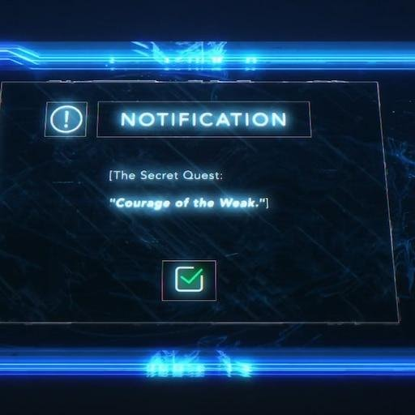

<!-- ========================================================================= -->
<!-- SOLO LEVELING • SHADOW MONARCH GITHUB PROFILE README                      -->
<!-- ========================================================================= -->

<div align="center">

<!-- CINEMATIC HERO SECTION -->
<p align="center">
  
</p>

# ⚡ PANKAJ RANA
### 🗡️ THE SHADOW DEVELOPER
**Computer Engineering Student • Full-Stack Developer • Continuous Leveling**

<p align="center">
  <em>"From E-Rank to Shadow Monarch. Every project is a quest. Every bug is a dungeon."</em>
</p>

<p align="center">
  <a href="https://www.linkedin.com/in/pankaj0536/" target="_blank">
    
  </a>
  &nbsp;
  <a href="https://x.com/Hey_P4JR2A" target="_blank">
    
  </a>
  &nbsp;
  <a href="mailto:pankajrana2754@gmail.com">
    
  </a>
  &nbsp;
  <a href="https://github.com/Hey-Pankaj" target="_blank">
    
  </a>
</p>

</div>

---

<!-- SECTION 1: SYSTEM STATUS WINDOW (MOBILE-FRIENDLY & AUTHENTIC) -->
<h2 align="center">📊 System Status Window</h2>

<table align="center" width="100%">
<tr>
<td>

```yaml
╔══════════════════════════════════════════════════════════════╗
║             [ SYSTEM STATUS WINDOW • ONLINE ]                ║
╠══════════════════════════════════════════════════════════════╣
║  HUNTER     : Pankaj Rana                                    ║
║  CLASS      : Computer Engineering Student / Developer       ║
║  TITLE      : The Shadow Developer                           ║
║  RANK       : Continuously Evolving                          ║
║  AFFINITY   : Full-Stack Systems & Applied AI / ML           ║
╠══════════════════════════════════════════════════════════════╣
║  [ HUNTER ECOSYSTEM ]                                        ║
║  • Beru     : AI & Computer Vision Commander                 ║
║  • Igris    : Backend Architecture Guardian                  ║
║  • Iron     : Infrastructure & Developer Tools Titan         ║
║  • Army     : Active Repositories & Experimental Builds      ║
╠══════════════════════════════════════════════════════════════╣
║  [ CURRENT OBJECTIVE ]                                       ║
║  "Become a stronger engineer. Solve real-world problems."    ║
║                                                              ║
║  [ SYSTEM DIRECTIVE ]                                        ║
║  "No shortcuts. Only consistent progression. ARISE."         ║
╚══════════════════════════════════════════════════════════════╝
```

</td>
</tr>
</table>

---

<!-- SECTION 2: THE DOUBLE DUNGEON (DEVELOPER JOURNEY) -->
<h2 align="center">🏛️ The Double Dungeon — The Developer Journey</h2>

<p align="center">
  
</p>

<table align="center" width="100%">
<tr>
<td width="33%" valign="top">
  <div align="center">
    <h4>🚪 01. The Gate</h4>
    <p><b>Where I Started</b></p>
  </div>
  <p>
    Stepped into Computer Engineering as an E-Rank novice. Started with raw C/C++, terminal commands, algorithmic foundations, and computational logic with zero shortcuts.
  </p>
</td>
<td width="33%" valign="top">
  <div align="center">
    <h4>⚔️ 02. The Trial</h4>
    <p><b>What I Learned</b></p>
  </div>
  <p>
    Confronted grueling compiler errors, broken states, and architectural bottlenecks. Learned that true engineering strength is forged through discipline and relentless debugging.
  </p>
</td>
<td width="33%" valign="top">
  <div align="center">
    <h4>👑 03. The Awakening</h4>
    <p><b>What I Am Becoming</b></p>
  </div>
  <p>
    Transitioned from learner to builder. Now architecting full-stack web applications, exploring computer vision pipelines, and building products with real-world impact.
  </p>
</td>
</tr>
</table>

---

<!-- SECTION 3: DAILY QUEST -->
<h2 align="center">📜 Daily Repeatable Quest</h2>

<table align="center" width="100%">
<tr>
<td width="28%" align="center" valign="middle">
  
</td>
<td width="72%" valign="top">

### `[SYSTEM NOTIFICATION]` • `COURAGE OF THE WEAK`
**Directive**: *Consistent daily execution to elevate core engineering stats.*

- [x] **Algorithmic Strength**: Daily problem solving across data structures and algorithms.
- [x] **Product Engineering**: Shipping active features and optimizing UX for **SANAIRO**.
- [x] **Applied Intelligence**: Deepening computer vision and recognition pipelines (**SAMS**).
- [x] **Architecture Discipline**: Refactoring code for readability, scalability, and performance.

*Daily Reward: Continuous EXP accumulation and unshakeable engineering stamina.*

</td>
</tr>
</table>

---

<!-- SECTION 4: SKILL AWAKENING TREE (AUTHENTIC LEARNING STAGES) -->
<h2 align="center">⚡ Skill Awakening Tree</h2>

<p align="center">
  <i>"Skills mapped by authentic stages of mastery rather than arbitrary numbers."</i>
</p>

<table align="center" width="100%">
<tr>
<td width="33%" valign="top">
  <div align="center">
    <h3>⚔️ Confident</h3>
    <small><b>Combat-Ready Runes</b></small>
  </div>
  <hr/>
  <p>Technologies used fluently for daily engineering and core problem-solving:</p>
  <ul>
    <li><b>Languages:</b> C, C++, Python, JavaScript</li>
    <li><b>Web Core:</b> HTML5, CSS3</li>
    <li><b>Hunter Gear:</b> Git, GitHub, VS Code</li>
  </ul>
</td>
<td width="33%" valign="top">
  <div align="center">
    <h3>🛡️ Building</h3>
    <small><b>Active Raid Stack</b></small>
  </div>
  <hr/>
  <p>Technologies actively deployed in real-world applications and architectures:</p>
  <ul>
    <li><b>Frontend:</b> React</li>
    <li><b>Backend:</b> Node.js</li>
    <li><b>Databases:</b> MySQL, MongoDB</li>
    <li><b>Design:</b> Figma</li>
  </ul>
</td>
<td width="33%" valign="top">
  <div align="center">
    <h3>🔮 Exploring</h3>
    <small><b>Skill Awakening</b></small>
  </div>
  <hr/>
  <p>Domains and frameworks currently under active research and expansion:</p>
  <ul>
    <li><b>Frameworks:</b> Next.js</li>
    <li><b>Vision:</b> OpenCV, DeepFace</li>
    <li><b>Advanced:</b> Machine Learning & Agentic Systems</li>
  </ul>
</td>
</tr>
</table>

<p align="center">
  
</p>

---

<!-- SECTION 5: THE SHADOW ARMY (DEVELOPER ECOSYSTEM) -->
<h2 align="center">👥 The Shadow Army — My Developer Ecosystem</h2>

<p align="center">
  <i>"Creative metaphors mapping the Monarch's loyal shadow commanders to specialized engineering domains."</i>
</p>

<table align="center" width="100%">
<tr>
<td width="33%" valign="top">
  <div align="center">
    
    <h4>⚔️ Igris</h4>
    <b>Backend Engineering</b>
  </div>
  <p>
    Disciplined, unwavering, and precise. Executes heavy-duty server architectures, reliable REST APIs, database queries, and system data flows.
  </p>
</td>
<td width="33%" valign="top">
  <div align="center">
    
    <h4>🛡️ Iron</h4>
    <b>Infrastructure & Tools</b>
  </div>
  <p>
    Indestructible vanguard. Holds the defensive line across Git version control, environment stability, developer tooling, and clean dependency management.
  </p>
</td>
<td width="33%" valign="top">
  <div align="center">
    
    <h4>🐜 Beru</h4>
    <b>AI & Computer Vision</b>
  </div>
  <p>
    Unrivaled speed and hyper-acute detection. Powers real-time visual recognition, automated image pipelines, and relentless bug extermination.
  </p>
</td>
</tr>
</table>

<!-- DIALOGUE METAPHOR -->
<table align="center" width="100%">
<tr>
<td>

> **🐜 Beru:** *"MY LIEGE! Another bug has appeared! Shall I eliminate it?"*  
> **👑 Sung Jin-Woo (Pankaj):** *"ARISE. Fix the bug."*  

<div align="right">
  <sub><i>*Creative metaphors for continuous testing, debugging, and domain exploration.*</i></sub>
</div>

</td>
</tr>
</table>

---

<!-- SECTION 6: DUNGEON CLEARANCE LOG (FEATURED PROJECTS & MILESTONES) -->
<h2 align="center">📜 Dungeon Clearance Log — Cleared Raids</h2>

<!-- QUEST 01: SAMS -->
<table align="center" width="100%">
<tr>
<td width="42%" align="center" valign="middle">
  <a href="https://github.com/Hey-Pankaj/sams-PL" target="_blank">
    
  </a>
</td>
<td width="58%" valign="top">

### ⚔️ `RAID 01` • SAMS (Smart Attendance Management System)
`RANK S QUEST` • `STATUS: COMPLETED / VERIFIED`

An automated computer vision attendance system designed to eliminate manual roll-calls and proxy check-ins. Detects faces from live video streams, extracts facial feature embeddings, and logs verified attendance into a central database in real time.

- **Stack**: `Python` • `OpenCV` • `DeepFace` • `Streamlit`
- **Key Features**: Live webcam face matching, multi-face verification, and exportable CSV attendance reports.
- **Repository**: [`github.com/Hey-Pankaj/sams-PL`](https://github.com/Hey-Pankaj/sams-PL) *(Source repository)*

</td>
</tr>
</table>

<br/>

<!-- QUEST 02: SANAIRO -->
<table align="center" width="100%">
<tr>
<td width="42%" align="center" valign="middle">
  <a href="https://sanairo.com" target="_blank">
    
  </a>
</td>
<td width="58%" valign="top">

### 🌟 `RAID 02` • SANAIRO (Self-Growth Social Platform)
`RANK S QUEST` • `STATUS: ACTIVE RAID / IN PRODUCTION`

A productive web platform engineered to combat doom-scrolling by cultivating meaningful daily habits, goal accountability, and mindful reflection within a supportive community of creators and builders.

- **Stack**: `React` • `Next.js` • `Node.js` • `MongoDB`
- **Key Features**: Habit streaks, daily accomplishment journaling, distraction-free feed, and creator circles.
- **Live Platform**: [**sanairo.com**](https://sanairo.com) *(Active production build; codebase in private development)*

</td>
</tr>
</table>

<br/>

<!-- QUEST 03: PARKBAY & MILESTONES -->
<table align="center" width="100%">
<tr>
<td width="50%" valign="top">

#### 🚗 `RAID 03` • ParkBay (Smart Parking Web App)
`RANK A QUEST` • `STATUS: CLEARED`

Smart parking management application offering real-time spot reservations, parking slot occupancy tracking, and administrative controls to relieve urban parking bottlenecks.

- **Stack**: `JavaScript` • `Node.js` • `MySQL` • `HTML5/CSS3`
- **Codebase**: Available on [`github.com/Hey-Pankaj`](https://github.com/Hey-Pankaj)

</td>
<td width="50%" valign="top">

#### 🏆 Guild Milestones & Cleared Events
`ACHIEVEMENT LOG` • `STATUS: LOGGED`

- 🏰 **Hackathon Raid**: Competed in intensive collaborative hackathons, ideating and prototyping functional solutions under strict time limits.
- 🎓 **Engineering Milestones**: Maintained rigorous coursework in Computer Engineering with focus on Software Engineering & Systems.
- 🚀 **Production Deployment**: Successfully published and deployed live consumer web services.

</td>
</tr>
</table>

---

<!-- SECTION 7: HUNTER PROGRESSION (RESTRAINED, SLEEK STATS) -->
<h2 align="center">📈 Hunter Progression & Guild Activity</h2>

<p align="center">
  
</p>

<p align="center">
  
  &nbsp;
  
</p>

---

<!-- SECTION 8: MONARCH'S FINAL MESSAGE -->
<div align="center">

<p align="center">
  
</p>

<h3><em>"Even in the darkest shadows, I continue to level up."</em></h3>

# 👑 ARISE!

<p align="center">
  <a href="https://www.linkedin.com/in/pankaj0536/" target="_blank">
    
  </a>
  &nbsp;
  <a href="https://x.com/Hey_P4JR2A" target="_blank">
    
  </a>
  &nbsp;
  <a href="mailto:pankajrana2754@gmail.com">
    
  </a>
  &nbsp;
  <a href="https://github.com/Hey-Pankaj" target="_blank">
    
  </a>
</p>

<p align="center">
  
</p>

</div>
