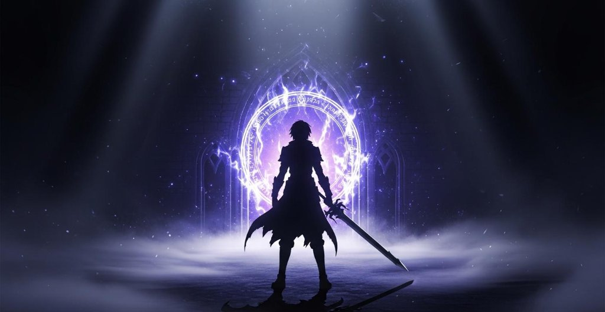

<!-- ========================================================================= -->
<!-- CLASSIFIED HUNTER ASSOCIATION DOSSIER • PANKAJ RANA                      -->
<!-- ========================================================================= -->

<div align="center">

<!-- CINEMATIC HERO BANNER -->
<p align="center">
  
</p>

`HUNTER ASSOCIATION DATABASE • CLASSIFIED DOSSIER #PR-0536`

# ⚡ PANKAJ RANA
### 🗡️ THE SHADOW DEVELOPER
**Computer Engineering Student • Full-Stack Developer • Applied AI Explorer**

<p align="center">
  <em>"From E-Rank to Shadow Monarch. Every project is a quest. Every bug is a dungeon."</em>
</p>

<!-- RESTYLED MINIMALIST HUNTER CHANNELS -->
<p align="center">
  <a href="https://www.linkedin.com/in/pankaj0536/" target="_blank">
    
  </a>
  &nbsp;
  <a href="https://github.com/Hey-Pankaj" target="_blank">
    
  </a>
  &nbsp;
  <a href="https://x.com/Hey_P4JR2A" target="_blank">
    
  </a>
  &nbsp;
  <a href="mailto:pankajrana2754@gmail.com">
    
  </a>
</p>

</div>

---

<!-- SECTION 1: SYSTEM HUD INTERFACE (CLEAN, AUTHENTIC & MOBILE-FRIENDLY) -->
<h2 align="center">📊 System Status HUD</h2>

<table align="center" width="100%">
<tr>
<td>

```yaml
╔══════════════════════════════════════════════════════════════╗
║               [ SYSTEM STATUS HUD • ONLINE ]                 ║
╠══════════════════════════════════════════════════════════════╣
║  HUNTER IDENTIFIER : Pankaj Rana                             ║
║  CLASSIFICATION    : Computer Engineering / Full-Stack Dev   ║
║  DESIGNATION       : The Shadow Developer                    ║
║  CURRENT STATUS    : Continuously Evolving (Daily Expansion) ║
║  SPECIALIZATION    : Modern Web Systems & Computer Vision    ║
╠══════════════════════════════════════════════════════════════╣
║  [ ACTIVE SHADOW ECOSYSTEM ]                                 ║
║  • Beru            : AI & Computer Vision Pipelines          ║
║  • Igris           : Backend Architecture & REST Services    ║
║  • Iron            : Infrastructure, Tooling & Environments  ║
╠══════════════════════════════════════════════════════════════╣
║  [ CURRENT DIRECTIVE ]                                       ║
║  "Become a stronger engineer. Build products that solve      ║
║   real-world problems. No shortcuts. ARISE."                 ║
╚══════════════════════════════════════════════════════════════╝
```

</td>
</tr>
</table>

---

<!-- SECTION 2: THE DEVELOPER JOURNEY (FACTUAL VISUAL PROGRESSION) -->
<h2 align="center">🏛️ The Progression Path — From Novice to Builder</h2>

<table align="center" width="100%">
<tr>
<td width="33%" valign="top">
  <div align="center">
    <h4>🚪 PHASE 01 • THE GATE</h4>
    <small><b>Engineering Foundations</b></small>
  </div>
  <p>
    Entered Computer Engineering with zero shortcuts. Mastered procedural logic, data structures, and computational foundations in <b>C</b> and <b>C++</b>.
  </p>
</td>
<td width="33%" valign="top">
  <div align="center">
    <h4>⚔️ PHASE 02 • THE RAID</h4>
    <small><b>Full-Stack Architecture</b></small>
  </div>
  <p>
    Transitioned into full-stack development. Built resilient web architectures, responsive frontends with <b>React</b>, and scalable backends using <b>Node.js</b> and <b>MySQL/MongoDB</b>.
  </p>
</td>
<td width="33%" valign="top">
  <div align="center">
    <h4>👑 PHASE 03 • THE AWAKENING</h4>
    <small><b>Applied Systems & Vision</b></small>
  </div>
  <p>
    Actively engineering production web products (<b>SANAIRO</b>) and intelligent automated computer vision pipelines (<b>SAMS</b>) to solve real problems.
  </p>
</td>
</tr>
</table>

---

<!-- SECTION 3: DUNGEON CLEARANCE LOG (PRIMARY PROJECT EVIDENCE) -->
<h2 align="center">📜 Dungeon Clearance Log — Featured Quests</h2>

<p align="center">
  <i>"Verified projects and architectures engineered to solve real-world problems."</i>
</p>

<!-- QUEST 01: SANAIRO -->
<table align="center" width="100%">
<tr>
<td width="48%" align="center" valign="middle">
  <a href="https://sanairo.com" target="_blank">
    
  </a>
</td>
<td width="52%" valign="top">

### 🌟 `QUEST 01` • SANAIRO (Self-Growth Social Platform)
`STATUS: ACTIVE RAID • IN PRODUCTION`

A mindful social web platform engineered to combat doom-scrolling. SANAIRO provides an intentional digital sanctuary where users cultivate daily habits, log personal reflections, and share accountable milestones with a supportive community.

- **Scope**: User authentication, habit tracking streaks, reflective journal feeds, and community circles.
- **Technologies**: `React` • `Next.js` • `Node.js` • `MongoDB`
- **Deployment**: [**sanairo.com**](https://sanairo.com) *(Active production build; codebase in private development)*

</td>
</tr>
</table>

<br/>

<!-- QUEST 02: SAMS -->
<table align="center" width="100%">
<tr>
<td width="48%" align="center" valign="middle">
  <a href="https://github.com/Hey-Pankaj/sams-PL" target="_blank">
    
  </a>
</td>
<td width="52%" valign="top">

### ⚔️ `QUEST 02` • SAMS (Smart Attendance Management System)
`STATUS: VERIFIED PROTOTYPE • ACADEMIC BUILD`

An automated computer vision attendance system designed to eliminate manual roll-calls and proxy check-ins. Detects faces from real-time webcam streams, extracts deep feature embeddings, and verifies student/employee attendance against a central database.

- **Scope**: Real-time multi-face detection, feature embedding matching, automated database logging, and CSV exports.
- **Technologies**: `Python` • `OpenCV` • `DeepFace` • `Streamlit`
- **Repository**: [`github.com/Hey-Pankaj/sams-PL`](https://github.com/Hey-Pankaj/sams-PL) *(Verified source repository)*

</td>
</tr>
</table>

<br/>

<!-- QUEST 03: PARKBAY & GUILD ACHIEVEMENTS -->
<table align="center" width="100%">
<tr>
<td width="50%" valign="top">

#### 🚗 `QUEST 03` • ParkBay (Smart Parking Web App)
`STATUS: COMPLETED ARCHITECTURE`

Smart parking management application offering real-time spot reservations, parking slot occupancy tracking, and administrative controls to relieve urban parking bottlenecks.

- **Stack**: `JavaScript` • `Node.js` • `MySQL` • `HTML5` • `CSS3`
- **Codebase**: Available on [`github.com/Hey-Pankaj`](https://github.com/Hey-Pankaj)

</td>
<td width="50%" valign="top">

#### 🏆 Guild Milestones & Development Records
`STATUS: LOGGED`

- 🏰 **Hackathon Raids**: Competed in intensive collaborative hackathons, ideating and prototyping functional solutions under strict time limits.
- 🎓 **Engineering Rigor**: Maintained dedicated coursework in Computer Engineering with focus on Software Systems and Applied Algorithms.
- 🚀 **Shipped Production Software**: Successfully authored and deployed live web platforms accessible to real users.

</td>
</tr>
</table>

---

<!-- SECTION 4: SKILL AWAKENING TREE (AUTHENTIC LEARNING STAGES) -->
<h2 align="center">⚡ Technical Arsenal & Learning Stages</h2>

<table align="center" width="100%">
<tr>
<td width="33%" valign="top">
  <div align="center">
    <h3>⚔️ Confident</h3>
    <small><b>Combat-Ready Runes</b></small>
  </div>
  <hr/>
  <p>Technologies used fluently for daily engineering and core problem-solving:</p>
  <ul>
    <li><b>Languages:</b> C, C++, Python, JavaScript</li>
    <li><b>Web Core:</b> HTML5, CSS3</li>
    <li><b>Hunter Gear:</b> Git, GitHub, VS Code</li>
  </ul>
</td>
<td width="33%" valign="top">
  <div align="center">
    <h3>🛡️ Building</h3>
    <small><b>Active Raid Stack</b></small>
  </div>
  <hr/>
  <p>Technologies actively deployed in real-world applications and architectures:</p>
  <ul>
    <li><b>Frontend:</b> React</li>
    <li><b>Backend:</b> Node.js</li>
    <li><b>Databases:</b> MySQL, MongoDB</li>
    <li><b>Design:</b> Figma</li>
  </ul>
</td>
<td width="33%" valign="top">
  <div align="center">
    <h3>🔮 Exploring</h3>
    <small><b>Skill Awakening</b></small>
  </div>
  <hr/>
  <p>Domains and frameworks currently under active research and expansion:</p>
  <ul>
    <li><b>Frameworks:</b> Next.js</li>
    <li><b>Vision:</b> OpenCV, DeepFace</li>
    <li><b>Advanced:</b> Machine Learning & Agentic Systems</li>
  </ul>
</td>
</tr>
</table>

<p align="center">
  
</p>

---

<!-- SECTION 5: THE SHADOW ARMY (METAPHORICAL DEVELOPER COMPANIONS) -->
<h2 align="center">👥 The Shadow Army — Developer Ecosystem</h2>

<p align="center">
  <i>"Fictional companion metaphors connecting the Monarch's commanders to specialized software domains."</i>
</p>

<table align="center" width="100%">
<tr>
<td width="33%" valign="top">
  <div align="center">
    
    <h4>⚔️ Igris</h4>
    <b>Backend Engineering</b>
  </div>
  <p>
    Disciplined, unwavering, and precise. Executes heavy-duty server architectures, robust REST APIs, clean database queries, and system data flows.
  </p>
</td>
<td width="33%" valign="top">
  <div align="center">
    
    <h4>🛡️ Iron</h4>
    <b>Infrastructure & Tools</b>
  </div>
  <p>
    Indestructible vanguard. Holds the defensive line across Git version control, environment stability, developer tooling, and clean dependency management.
  </p>
</td>
<td width="33%" valign="top">
  <div align="center">
    
    <h4>🐜 Beru</h4>
    <b>AI & Computer Vision</b>
  </div>
  <p>
    Unrivaled speed and hyper-acute detection. Powers real-time visual recognition, automated image pipelines, and relentless bug extermination.
  </p>
</td>
</tr>
</table>

<!-- DIALOGUE METAPHOR -->
<table align="center" width="100%">
<tr>
<td>

> **🐜 Beru:** *"MY LIEGE! Another bug has appeared! Shall I eliminate it?"*  
> **👑 Sung Jin-Woo (Pankaj):** *"ARISE. Fix the bug."*  

<div align="right">
  <sub><i>*Metaphors representing continuous unit testing, debugging, and engineering rigor.*</i></sub>
</div>

</td>
</tr>
</table>

---

<!-- SECTION 6: HUNTER ANALYTICS (ELEGANT & RESTRAINED) -->
<h2 align="center">📈 Hunter Progression & Guild Activity</h2>

<p align="center">
  
</p>

<p align="center">
  
  &nbsp;
  
</p>

---

<!-- SECTION 7: MONARCH'S FINAL DIRECTIVE -->
<div align="center">

<p align="center">
  
</p>

`[SYSTEM DIRECTIVE • SESSION CLOSE]`
<h3><em>"Even in the darkest shadows, I continue to level up."</em></h3>

# 👑 ARISE.

<p align="center">
  <a href="https://www.linkedin.com/in/pankaj0536/" target="_blank">
    
  </a>
  &nbsp;
  <a href="https://github.com/Hey-Pankaj" target="_blank">
    
  </a>
  &nbsp;
  <a href="https://x.com/Hey_P4JR2A" target="_blank">
    
  </a>
  &nbsp;
  <a href="mailto:pankajrana2754@gmail.com">
    
  </a>
</p>

<p align="center">
  
</p>

</div>
