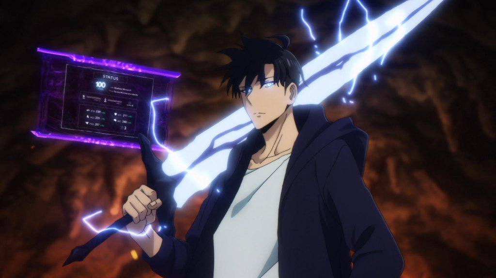
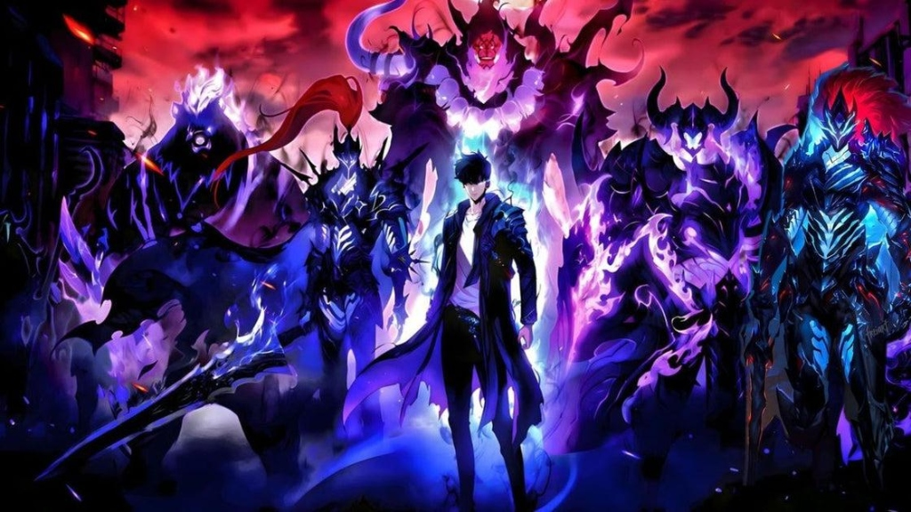

<!-- ========================================================================= -->
<!-- SOLO LEVELING • SHADOW MONARCH GITHUB PROFILE README                      -->
<!-- ========================================================================= -->

  

  

  

<!-- SIGNATURE HUNTER PROFILE CARD -->
<table align="center" width="100%">
<tr>
<td>

`HUNTER PROFILE • SHADOW MONARCH`
# ⚡ PANKAJ RANA
### *THE DEVELOPER WHO KEEPS LEVELING UP.*

---

| **SPECIFICATION** | **DATA RECORD** |
| :--- | :--- |
| **HUNTER CLASS** | `Full-Stack Developer` |
| **HUNTER RANK** | `Continuously Evolving` |
| **SHADOW COMPANION** | `BERU (Shadow Marshal)` 🐜 |
| **CURRENT MISSION** | `BUILD. LEARN. ARISE.` 🚀 |

</td>
</tr>
</table>

  
  &nbsp;&nbsp;
  
  &nbsp;&nbsp;
  
  &nbsp;&nbsp;
  

---

<!-- SECTION B: HUNTER STATUS WINDOW -->
<h2 align="center">📊 [ SYSTEM STATUS WINDOW ]</h2>

  

  <i>"The System chose me. In return, I chose to never stop evolving."</i>

<table align="center">
<tr>
<td>

<pre>
╔══════════════════════════════════════════════════════════════════════════════════════════╗
║                                 [ SYSTEM STATUS WINDOW ]                                 ║
╠══════════════════════════════════════════════════════════════════════════════════════════╣
║  HUNTER NAME   : Pankaj Rana                    CLASS   : Full-Stack Developer           ║
║  TITLE         : Shadow Monarch                 LEVEL   : 100 [Leveling Continuously]    ║
║  RANK          : S-Rank (Continuously Evolving) FATIGUE : 0%                             ║
║  COMPANION     : Beru (Shadow Marshal)          GUILD   : Independent Builder            ║
╠══════════════════════════════════════════════════════════════════════════════════════════╣
║  HP   [████████████████████████████████████████] 10,000 / 10,000                         ║
║  MP   [████████████████████████████████████████]  9,500 /  9,500  (Coffee Infused)       ║
╠══════════════════════════════════════════════════════════════════════════════════════════╣
║  [ CORE ABILITY STATS ]                                                                  ║
║  • STR  (Algorithmic Strength & DSA) : 155    • VIT (Engineering Consistency) : 160      ║
║  • AGI  (Execution & Fast Prototyping): 165    • INT (Software Architecture)   : 172      ║
║  • PER  (Debugging & Code Quality)   : 158    • MANA (Deep Learning & Passion): 999      ║
╠══════════════════════════════════════════════════════════════════════════════════════════╣
║  [ PASSIVE & ACTIVE SKILLS ]                                                             ║
║  ▸ [Passive] Continuous Leveling : Relentless daily self-upgrade and skill acquisition.  ║
║  ▸ [Active]  Shadow Extraction   : Extracts robust production software from raw ideas.   ║
║  ▸ [Active]  Monarch's Domain    : Deploys scalable Full-Stack & AI distributed systems. ║
║  ▸ [Active]  Ruler's Authority   : Precision debugging, profiling, and optimization.     ║
╚══════════════════════════════════════════════════════════════════════════════════════════╝
</pre>

</td>
</tr>
</table>

---

<!-- SECTION C: ABOUT ME -->
<h2 align="center">⚔️ The Hunter Behind The Screen</h2>

  I'm <b>Pankaj Rana</b> — a <b>Computer Engineering Student</b> and <b>Full-Stack Developer</b> who stepped through the gate into the world of software. Just like the Shadow Monarch who started from the weakest rank and relentlessly leveled up through discipline and perseverance, every bug conquered and system deployed becomes permanent strength.

<table align="center" width="100%">
<tr>
<td width="33%" valign="top">
  

    <h3>🌐 Full-Stack Systems</h3>
    
Designing modern, responsive end-to-end architectures from resilient Node/database backends to reactive component libraries.

  

</td>
<td width="33%" valign="top">
  

    <h3>🤖 AI & Computer Vision</h3>
    
Exploring deep learning models, automated facial detection, visual processing pipelines, and agentic workflows.

  

</td>
<td width="33%" valign="top">
  

    <h3>🚀 Startups & Innovation</h3>
    
Transforming concepts into real-world software products, solving practical problems and empowering user self-growth.

  

</td>
</tr>
</table>

---

<!-- SECTION D: TECH ARSENAL -->
<h2 align="center">🛠️ Technical Arsenal & Abilities</h2>

<table align="center" width="100%">
<tr>
<td width="50%" valign="top">
  <b>🗡️ Core Languages [Fundamental Runes]</b>  
  
  
  
  
  
</td>
<td width="50%" valign="top">
  <b>🛡️ Frontend & UI [Shadow Constructs]</b>  
  
  
  
  
</td>
</tr>
<tr>
<td width="50%" valign="top">
  <b>🔮 Backend & Databases [Dungeon Infrastructure]</b>  
  
  
  
</td>
<td width="50%" valign="top">
  <b>⚙️ Hunter Armory [Equipped Gear]</b>  
  
  
  
  
</td>
</tr>
</table>

  

---

<!-- SECTION E: FEATURED QUESTS -->
<h2 align="center">📜 Completed Quests & Cleared Dungeons</h2>

  

  <i>"Each completed quest raises the army of software solutions standing guard in the shadows."</i>

<table align="center" width="100%">
<tr>
<td width="50%" valign="top">
  

    <h3>⚔️ [Rank S Quest] SAMS</h3>
    <b>Smart Attendance Management System</b>
  

  

    An intelligent vision pipeline that detects, verifies, and logs student and employee attendance in real-time with automated facial recognition, liveness verification, and secure database reporting.
  

  

    
    
    
    
  

  

    
  

</td>
<td width="50%" valign="top">
  

    <h3>🌟 [Rank S Quest] SANAIRO</h3>
    <b>Self-Growth & Mindful Social Media Platform</b>
  

  

    A productive social ecosystem engineered to counter addictive doom-scrolling, empowering users to cultivate meaningful daily habits, track self-growth, and collaborate with like-minded creators.
  

  

    
    
    
    
  

  

    
  

</td>
</tr>
<tr>
<td colspan="2" valign="top">
  

    <h3>🚗 [Rank A Quest] ParkBay</h3>
    <b>Smart Parking Management & Allocation Web System</b>
    

      An intelligent urban mobility solution offering real-time parking spot reservations, automated occupancy tracking, role-based admin navigation, and responsive live availability monitoring.
    

    

      
      
      
      
      
    

    
  

</td>
</tr>
</table>

---

<!-- SECTION F: GITHUB ACTIVITY -->
<h2 align="center">📈 Hunter Progression & Guild Records</h2>

  
  &nbsp;
  

  

---

<!-- SECTION G: BERU COMPANION -->
<h2 align="center">🐜 Shadow Commander: Beru</h2>

  

<table align="center" width="100%">
<tr>
<td>

### 👑 `DIALOGUE` • `BERU TO HIS MONARCH`

> *"KIEEEEK! My Liege! The code is compiled, the test suites have triumphed, and all memory leaks have been mercilessly eradicated from the dungeon! What realm shall we conquer next for Your Majesty?"*

---

**⚔️ DESIGNATION:** Shadow Marshal & Chief Executioner of Deadlines  
**🛡️ ATTRIBUTES:** Absolute Loyalty • Sub-Millisecond Latency • Unstoppable Drive  

- ⚡ **Guardian of Builds:** Watches over automated continuous integration and intercepts runtime anomalies before they surface.
- 🚀 **Speed & Optimization:** Executes background tasks, caching, and algorithmic refactoring at lightning speed.
- 🛡️ **Devoted Protector:** Standing guard 24/7 over active microservices, APIs, and production deployments.

</td>
</tr>
</table>

---

<!-- SECTION H: CURRENT MISSION -->
<h2 align="center">🎯 Current Active Mission</h2>

<table align="center" width="100%">
<tr>
<td>

### 📜 `SYSTEM DIRECTIVE` • `DAILY OBJECTIVES`

- 🚀 **Main Quest**: Accelerating development on **SANAIRO** and shipping innovative full-stack software.
- 🧠 **Daily Dungeon**: Leveling up **Data Structures & Algorithms** across advanced graph theories and dynamic programming.
- 🤖 **Skill Awakening**: Deepening explorations in **Computer Vision**, automated recognition pipelines, and agentic workflows.
- ⚡ **Current State**: Operating with high mana reserves, clean architectures, and relentless momentum.

</td>
</tr>
</table>

---

<!-- SECTION I: FOOTER -->

  
  &nbsp;
  

  <i>"Even in the darkest shadows, I continue to level up."</i>

  

