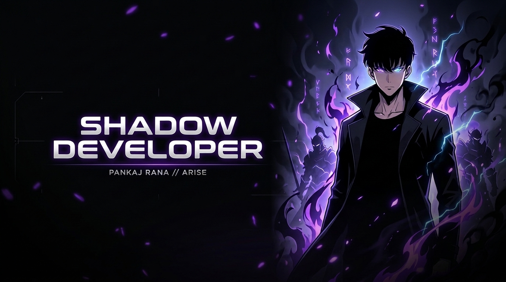
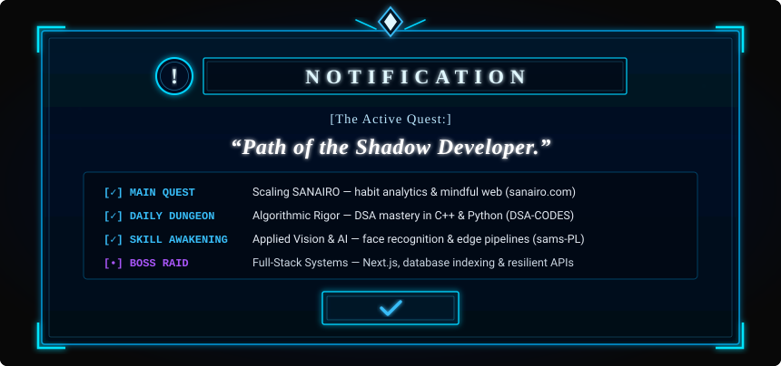
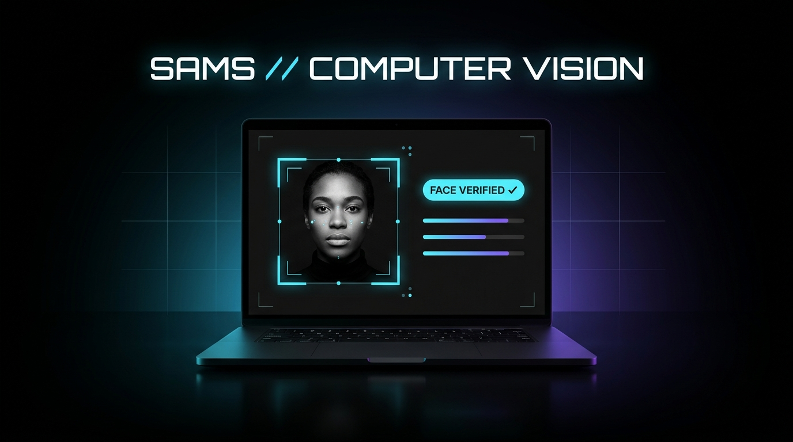
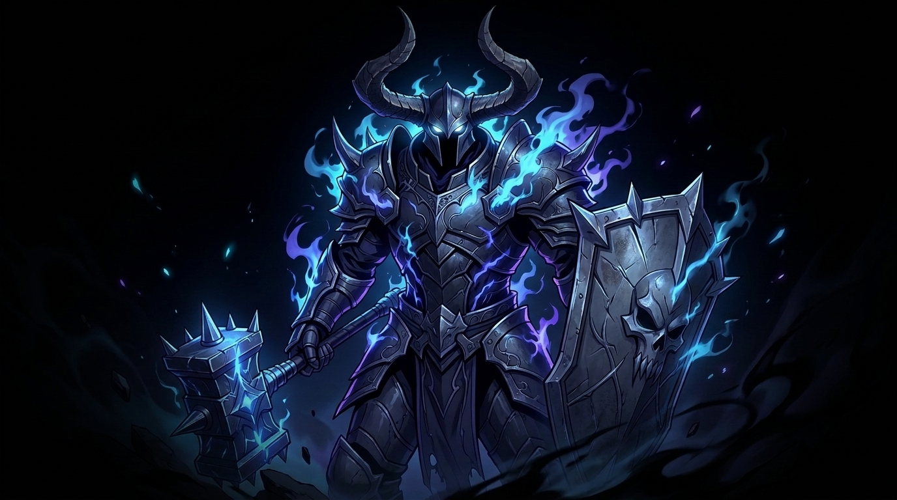

<!-- ========================================================================= -->
<!-- SHADOW DEVELOPER • CLASSIFIED HUNTER DOSSIER (PANKAJ RANA)                -->
<!-- ========================================================================= -->

<!-- 01. CINEMATIC HERO BANNER (NANO BANANA) -->

  

<!-- MINIMAL HOLOGRAPHIC SYSTEM INTERFACE -->

  

  

<!-- SECTION 1: LIVE SYSTEM STATUS HUD -->
<h2 align="center">📊 System Status HUD</h2>

  

  

<!-- SECTION 2: BEYOND THE CODE (THE HUMAN BEHIND THE MONARCH) -->
<h2 align="center">👤 Beyond the Code — The Human Behind the Shadow</h2>

  <i>"Code is the tool; curiosity and purpose are the engine."</i>

<table align="center" width="100%">
<tr>
<td width="50%" valign="top">

#### 🎓 Engineering & Product Building
- **Computer Engineering Student**: Focused on computer science fundamentals, scalable web systems, and applied artificial intelligence.
- **Builder of SANAIRO**: Architecting a mindful social platform designed to replace mindless scrolling with intentional daily habits, reflection, and peer accountability.
- **Product & Startup Minded**: Passionate about turning raw code into software people actually value and use daily.

</td>
<td width="50%" valign="top">

#### ⚛️ Physics Educator & Community
- **Physics Educator (Class 11 & 12)**: Mentoring senior secondary students in physics—distilling mechanics, electromagnetism, and calculus into intuitive first-principles models.
- **First-Principles Thinking**: Teaching physics sharpens engineering clarity; both require deconstructing complex problems into simple, verifiable laws.
- **Tech Community**: Active participant in student developer circles, campus hackathons, and open-source builds.

</td>
</tr>
</table>

  

<!-- SECTION 3: CURRENT QUEST NOTIFICATION (SOLO LEVELING SYSTEM WINDOW) -->
<h2 align="center">🎯 Current Quest — System Notification</h2>

  

  

<!-- SECTION 4: DUNGEON CLEARANCE LOG (FEATURED PROJECTS) -->
<h2 align="center">📜 Dungeon Clearance Log — Featured Quests</h2>

  <i>"Verified builds engineered to solve real-world problems."</i>

<!-- FLAGSHIP SPOTLIGHT: SANAIRO -->
<table align="center" width="100%">
<tr>
<td width="52%" align="center" valign="middle">
  
</td>
<td width="48%" valign="top">

### 🌟 `FLAGSHIP RAID` • SANAIRO
`STATUS: ACTIVE PRODUCTION`

A mindful social ecosystem built to combat doom-scrolling. Gives users an intentional space to track habits, log personal reflections, and share milestones with accountable peers.

- **Scope**: Authentication, habit streaks, reflective journal feeds, and community circles.
- **Stack**: `React` • `Next.js` • `Node.js` • `MongoDB`

  

<i>Active production build; codebase currently in private development.</i>

</td>
</tr>
</table>

 

<!-- 2-COLUMN ENGINEERING RAIDS GALLERY: SAMS & PARKBAY -->
<table align="center" width="100%">
<tr>
<td width="50%" align="center" valign="middle">
  
</td>
<td width="50%" align="center" valign="middle">
  
</td>
</tr>
<tr>
<td width="50%" valign="top">

#### ⚔️ `QUEST 02` • SAMS
`VERIFIED PROTOTYPE • ACADEMIC BUILD`

Real-time computer vision attendance system using live webcam streams and deep facial embeddings to automate attendance logging and prevent proxy check-ins.

- **Stack**: `Python` • `OpenCV` • `DeepFace` • `Streamlit`

  

</td>
<td width="50%" valign="top">

#### 🚗 `QUEST 03` • ParkBay
`COMPLETED ARCHITECTURE • VISION IOT`

Automated urban parking & vision IoT platform pairing overhead bay-detection surveillance telemetry with real-time slot booking and analytics.

- **Stack**: `JavaScript` • `Node.js` • `Python` • `MySQL` • `HTML/CSS`

  

</td>
</tr>
</table>

<!-- ADDITIONAL REPOSITORIES VAULT -->
<table align="center" width="100%">
<tr>
<td width="33%" valign="top">
  <b>🌿 <a href="https://github.com/Hey-Pankaj/DUSTBIN-OVERFLOW-DETECTOR-" target="_blank">Dustbin Overflow Detector</a></b> 
  Hardware &amp; IoT waste-level monitoring system with overflow alerts.
</td>
<td width="33%" valign="top">
  <b>⚡ <a href="https://github.com/Hey-Pankaj/DSA-CODES" target="_blank">DSA-CODES</a></b> 
  Curated algorithms &amp; data structures implementations in C++ and Python.
</td>
<td width="33%" valign="top">
  <b>🌐 <a href="https://github.com/Hey-Pankaj/WEB-DEVELOPMENT-CODES" target="_blank">WEB-DEVELOPMENT-CODES</a></b> 
  Full-stack prototypes, UI experiments, and backend API scripts.
</td>
</tr>
<tr>
<td colspan="3" align="center">
  <a href="https://github.com/Hey-Pankaj?tab=repositories" target="_blank">
    <b>👉 Explore All Repositories on GitHub &rarr;</b>
  </a>
</td>
</tr>
</table>

  

<!-- SECTION 5: SKILL AWAKENING TREE (AUTHENTIC LEARNING STAGES) -->
<h2 align="center">⚡ Technical Arsenal & Learning Stages</h2>

<table align="center" width="100%">
<tr>
<td width="33%" valign="top">
  

    <h4>⚔️ Confident</h4>
    <b>Combat-Ready Runes</b>
  

  

  
<b>Languages:</b> <code>C</code> <code>C++</code> <code>Python</code> <code>JavaScript</code>

  
<b>Web Core:</b> <code>HTML5</code> <code>CSS3</code>

  
<b>Tooling:</b> <code>Git</code> <code>GitHub</code> <code>VS Code</code>

</td>
<td width="33%" valign="top">
  

    <h4>🛡️ Building</h4>
    <b>Active Raid Stack</b>
  

  

  
<b>Frontend:</b> <code>React</code>

  
<b>Backend:</b> <code>Node.js</code>

  
<b>Databases:</b> <code>MySQL</code> <code>MongoDB</code>

  
<b>Design:</b> <code>Figma</code>

</td>
<td width="33%" valign="top">
  

    <h4>🔮 Exploring</h4>
    <b>Skill Awakening</b>
  

  

  
<b>Frameworks:</b> <code>Next.js</code> <code>Java</code>

  
<b>Vision:</b> <code>OpenCV</code> <code>DeepFace</code>

  
<b>Focus:</b> <code>Applied AI / ML</code>

</td>
</tr>
</table>

  

  

<!-- SECTION 6: THE SHADOW ARMY (METAPHORICAL DEVELOPER COMPANIONS) -->
<h2 align="center">👥 The Shadow Army — Developer Ecosystem</h2>

  <i>"Companion metaphors mapping the Monarch's commanders to engineering disciplines."</i>

<table align="center" width="100%">
<tr>
<td width="33%" align="center" valign="middle">
  
</td>
<td width="33%" align="center" valign="middle">
  
</td>
<td width="33%" align="center" valign="middle">
  
</td>
</tr>
<tr>
<td width="33%" valign="top">
  

    <h4>⚔️ Igris • Backend Engineering</h4>
  

  

    Disciplined and precise. Executes resilient server logic, REST APIs, database queries, and core data architecture.
  

</td>
<td width="33%" valign="top">
  

    <h4>🛡️ Iron • Infrastructure & Tools</h4>
  

  

    Indestructible vanguard. Protects Git workflows, environment stability, dependencies, and clean build setups.
  

</td>
<td width="33%" valign="top">
  

    <h4>🐜 Beru • AI & Computer Vision</h4>
  

  

    Unrivaled speed and razor-sharp vision. Drives real-time image pipelines, detection models, and bug extermination.
  

</td>
</tr>
</table>

<!-- DIALOGUE METAPHOR -->
<table align="center" width="100%">
<tr>
<td>

> **🐜 Beru:** *"MY LIEGE! Another bug has appeared! Shall I eliminate it?"*  
> **👑 Shadow Developer:** *"ARISE. Fix the bug."*  

  <i>*Metaphors representing continuous unit testing, debugging, and engineering rigor.*</i>

</td>
</tr>
</table>

  

<!-- SECTION 7: HUNTER PROGRESSION (RESTRAINED ANALYTICS) -->
<h2 align="center">📈 Hunter Progression & Guild Activity</h2>

  

  

  

<!-- SECTION 8: COLLABORATION & MONARCH'S CLOSING DIRECTIVE -->

  

<h2>🤝 Have an interesting idea? Let's build something meaningful.</h2>

  Whether you want to discuss full-stack software, collaborate on an applied AI project, talk physics, 
  or build something impactful together — my channels are always open.

  
  &nbsp;
  
  &nbsp;
  
  &nbsp;
  

 

`SHADOW DEVELOPER // PANKAJ RANA`
<h3><em>"Even in the darkest shadows, I continue to level up."</em></h3>

# 👑 ARISE.

  

