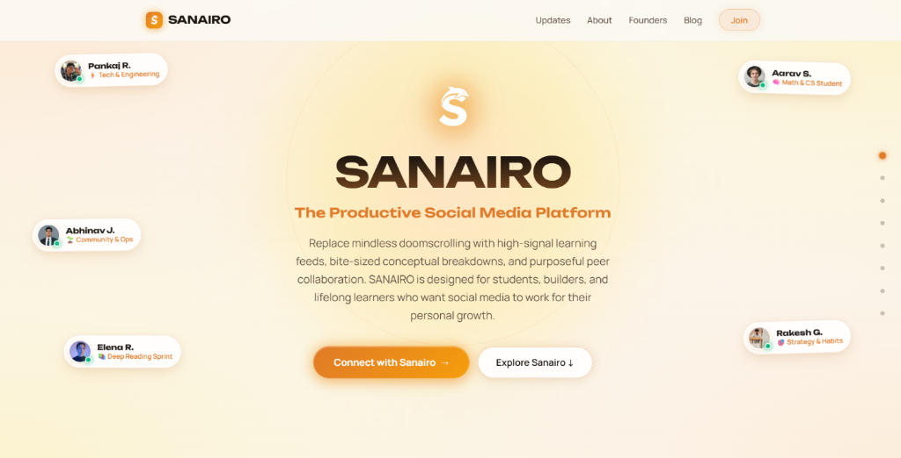
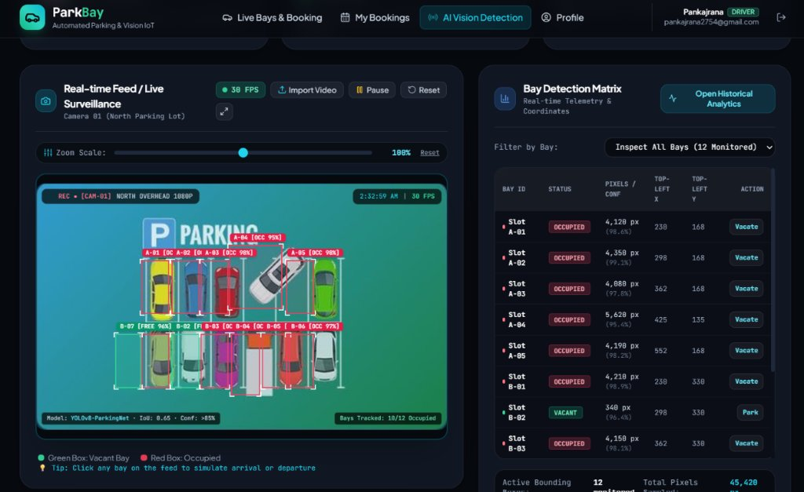

<!-- ========================================================================= -->
<!-- CLASSIFIED HUNTER ASSOCIATION DOSSIER • PANKAJ RANA                      -->
<!-- ========================================================================= -->

<!-- CINEMATIC HERO BANNER -->

  

`HUNTER ASSOCIATION DATABASE • CLASSIFIED DOSSIER #PR-0536`

# ⚡ PANKAJ RANA
### 🗡️ THE SHADOW DEVELOPER
**Computer Engineering Student • Builder of SANAIRO • Physics Educator**

  <em>"From E-Rank to Shadow Monarch. Every project is a quest. Every bug is a dungeon."</em>

<!-- ACTION CHANNELS -->

  
  &nbsp;
  
  &nbsp;
  
  &nbsp;
  

---

<!-- SECTION 1: SYSTEM STATUS HUD -->
<h2 align="center">📊 System Status HUD</h2>

  

---

<!-- SECTION 2: BEYOND THE CODE (THE HUMAN BEHIND THE MONARCH) -->
<h2 align="center">👤 Beyond the Code — The Human Behind the Monarch</h2>

  <i>"Code is the tool; curiosity and purpose are the engine."</i>

<table align="center" width="100%">
<tr>
<td width="50%" valign="top">

#### 🎓 Engineering & Product Building
- **Computer Engineering Student**: Deeply invested in computer science fundamentals, distributed web systems, and applied artificial intelligence.
- **Builder of SANAIRO**: Architecting a mindful social web ecosystem designed to replace mindless scrolling with intentional daily habits, reflection, and peer accountability.
- **Product & Startup Curious**: Fascinated by startup engineering, product-market fit, and turning raw logic into software that genuinely helps people.

</td>
<td width="50%" valign="top">

#### ⚛️ Physics Educator & Community
- **Physics Educator (Class 11 & 12)**: Mentoring senior secondary students in foundational physics. Breaking down complex mechanics, electromagnetism, and calculus into intuitive, first-principles mental models.
- **First-Principles Thinking**: Teaching physics directly sharpens algorithmic problem-solving—both require deconstructing complex chaos into simple, verifiable laws.
- **Community & Hackathons**: Active collaborator in developer circles, campus technical events, and open-source explorations.

</td>
</tr>
</table>

---

<!-- SECTION 3: CURRENT MISSION (ACTIVE PRIORITIES) -->
<h2 align="center">🎯 Current Mission — Active Directives</h2>

  <i>"Active learning priorities and ongoing development sprints."</i>

<table align="center" width="100%">
<tr>
<td>

- 🚀 **Main Raid • Scaling SANAIRO**: Iterating on habit tracking analytics, distraction-free feeds, and real-time community rooms on [sanairo.com](https://sanairo.com).
- 🧠 **Daily Dungeon • Algorithmic Rigor (DSA)**: Daily competitive problem solving in C++ and Python across graphs, dynamic programming, and complexity optimization ([DSA-CODES](https://github.com/Hey-Pankaj/DSA-CODES)).
- 🤖 **Skill Awakening • Applied Vision & AI**: Deepening real-time feature extraction, facial recognition models, and pipeline optimization ([sams-PL](https://github.com/Hey-Pankaj/sams-PL)).
- ⚡ **Architecture Focus • Full-Stack Maturity**: Expanding full-stack Next.js patterns, robust database indexing, and resilient REST microservices.

</td>
</tr>
</table>

---

<!-- SECTION 4: DUNGEON CLEARANCE LOG (FEATURED PROJECTS) -->
<h2 align="center">📜 Dungeon Clearance Log — Featured Quests</h2>

  <i>"Verified projects and architectures engineered to solve real-world problems."</i>

<!-- QUEST 01: SANAIRO -->
<table align="center" width="100%">
<tr>
<td width="48%" align="center" valign="middle">
  
</td>
<td width="52%" valign="top">

### 🌟 `QUEST 01` • SANAIRO (Self-Growth Social Platform)
`STATUS: ACTIVE RAID • IN PRODUCTION`

A mindful social web platform engineered to combat doom-scrolling. SANAIRO provides an intentional digital sanctuary where users cultivate daily habits, log personal reflections, and share accountable milestones with a supportive community.

- **Scope**: User authentication, habit tracking streaks, reflective journal feeds, and community circles.
- **Technologies**: `React` • `Next.js` • `Node.js` • `MongoDB`
- **Deployment**: [**sanairo.com**](https://sanairo.com) *(Active production build; codebase in private development)*

</td>
</tr>
</table>

 

<!-- QUEST 02: SAMS -->
<table align="center" width="100%">
<tr>
<td width="48%" align="center" valign="middle">
  
</td>
<td width="52%" valign="top">

### ⚔️ `QUEST 02` • SAMS (Smart Attendance Management System)
`STATUS: VERIFIED PROTOTYPE • ACADEMIC BUILD`

An automated computer vision attendance system designed to eliminate manual roll-calls and proxy check-ins. Detects faces from real-time webcam streams, extracts deep feature embeddings, and verifies student/employee attendance against a central database.

- **Scope**: Real-time multi-face detection, feature embedding matching, automated database logging, and CSV exports.
- **Technologies**: `Python` • `OpenCV` • `DeepFace` • `Streamlit`
- **Repository**: [`github.com/Hey-Pankaj/sams-PL`](https://github.com/Hey-Pankaj/sams-PL) *(Verified source repository)*

</td>
</tr>
</table>

 

<!-- QUEST 03: PARKBAY -->
<table align="center" width="100%">
<tr>
<td width="48%" align="center" valign="middle">
  
</td>
<td width="52%" valign="top">

### 🚗 `QUEST 03` • ParkBay (Automated Parking & Vision IoT)
`STATUS: COMPLETED ARCHITECTURE • VISION IOT`

An intelligent urban parking management system combining computer vision surveillance with automated slot booking. Employs real-time bay detection matrices and overhead camera tracking to monitor parking occupancy and streamline slot allocation.

- **Scope**: Real-time camera telemetry, automated bay occupancy detection, live slot booking, and driver analytics.
- **Technologies**: `JavaScript` • `Node.js` • `Python` • `MySQL` • `HTML5` • `CSS3`
- **Repository**: [`github.com/Hey-Pankaj/parkbay`](https://github.com/Hey-Pankaj/parkbay) *(Verified source repository)*

</td>
</tr>
</table>

<!-- ADDITIONAL REPOSITORIES ACCORDION / SUMMARY -->
<table align="center" width="100%">
<tr>
<td>

#### 📂 Additional Cleared Dungeons & Code Repositories
- 🌿 [**Dustbin Overflow Detector**](https://github.com/Hey-Pankaj/DUSTBIN-OVERFLOW-DETECTOR-): Hardware & IoT waste-level monitoring system with automated overflow alerts for smart sanitation.
- ⚡ [**DSA-CODES**](https://github.com/Hey-Pankaj/DSA-CODES): Problem-solving repository featuring data structure and algorithmic implementations in C++ and Python.
- 🌐 [**WEB-DEVELOPMENT-CODES**](https://github.com/Hey-Pankaj/WEB-DEVELOPMENT-CODES): Collection of full-stack prototypes, experimental UI components, and API integration scripts.

  <a href="https://github.com/Hey-Pankaj?tab=repositories" target="_blank">
    <b>👉 Explore All Repositories on GitHub &rarr;</b>
  </a>

</td>
</tr>
</table>

---

<!-- SECTION 5: SKILL AWAKENING TREE (AUTHENTIC LEARNING STAGES) -->
<h2 align="center">⚡ Technical Arsenal & Learning Stages</h2>

<table align="center" width="100%">
<tr>
<td width="33%" valign="top">
  

    <h3>⚔️ Confident</h3>
    <small><b>Combat-Ready Runes</b></small>
  

  

  
Technologies used fluently for daily engineering and core problem-solving:

  <ul>
    <li><b>Languages:</b> C, C++, Python, JavaScript</li>
    <li><b>Web Core:</b> HTML5, CSS3</li>
    <li><b>Hunter Gear:</b> Git, GitHub, VS Code</li>
  </ul>
</td>
<td width="33%" valign="top">
  

    <h3>🛡️ Building</h3>
    <small><b>Active Raid Stack</b></small>
  

  

  
Technologies actively deployed in real-world applications and architectures:

  <ul>
    <li><b>Frontend:</b> React</li>
    <li><b>Backend:</b> Node.js</li>
    <li><b>Databases:</b> MySQL, MongoDB</li>
    <li><b>Design:</b> Figma</li>
  </ul>
</td>
<td width="33%" valign="top">
  

    <h3>🔮 Exploring</h3>
    <small><b>Skill Awakening</b></small>
  

  

  
Domains and frameworks currently under active research and expansion:

  <ul>
    <li><b>Frameworks:</b> Next.js</li>
    <li><b>Vision:</b> OpenCV, DeepFace</li>
    <li><b>Advanced:</b> Machine Learning & Agentic Systems</li>
  </ul>
</td>
</tr>
</table>

  

---

<!-- SECTION 6: THE SHADOW ARMY (METAPHORICAL DEVELOPER COMPANIONS) -->
<h2 align="center">👥 The Shadow Army — Developer Ecosystem</h2>

  <i>"Fictional companion metaphors connecting the Monarch's commanders to specialized software domains."</i>

<table align="center" width="100%">
<tr>
<td width="33%" valign="top">
  

    
    <h4>⚔️ Igris</h4>
    <b>Backend Engineering</b>
  

  

    Disciplined, unwavering, and precise. Executes heavy-duty server architectures, reliable REST APIs, clean database queries, and system data flows.
  

</td>
<td width="33%" valign="top">
  

    
    <h4>🛡️ Iron</h4>
    <b>Infrastructure & Tools</b>
  

  

    Indestructible vanguard. Holds the defensive line across Git version control, environment stability, developer tooling, and clean dependency management.
  

</td>
<td width="33%" valign="top">
  

    
    <h4>🐜 Beru</h4>
    <b>AI & Computer Vision</b>
  

  

    Unrivaled speed and hyper-acute detection. Powers real-time visual recognition, automated image pipelines, and relentless bug extermination.
  

</td>
</tr>
</table>

<!-- DIALOGUE METAPHOR -->
<table align="center" width="100%">
<tr>
<td>

> **🐜 Beru:** *"MY LIEGE! Another bug has appeared! Shall I eliminate it?"*  
> **👑 Sung Jin-Woo (Pankaj):** *"ARISE. Fix the bug."*  

  <i>*Metaphors representing continuous unit testing, debugging, and engineering rigor.*</i>

</td>
</tr>
</table>

---

<!-- SECTION 7: HUNTER PROGRESSION (RESTRAINED ANALYTICS) -->
<h2 align="center">📈 Hunter Progression & Guild Activity</h2>

  

  

---

<!-- SECTION 8: COLLABORATION & MONARCH'S CLOSING DIRECTIVE -->

  

<h2>🤝 Have an interesting idea? Let's build something meaningful.</h2>

  Whether you want to discuss full-stack software, collaborate on an applied AI project, talk physics, 
  or build something impactful together — my channels are always open.

  
  &nbsp;
  
  &nbsp;
  
  &nbsp;
  

 

`[SYSTEM DIRECTIVE • SESSION CLOSE]`
<h3><em>"Even in the darkest shadows, I continue to level up."</em></h3>

# 👑 ARISE.

  

